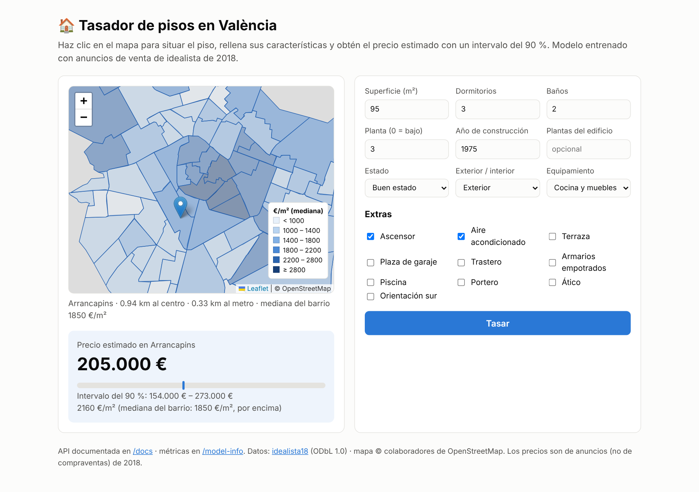
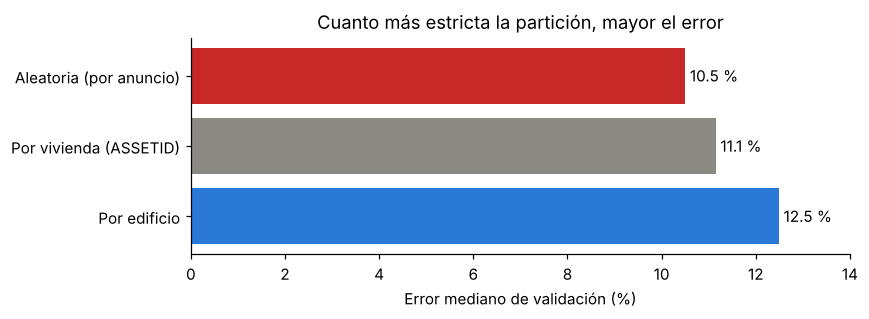

# 🏠 Tasador de pisos en València · API de machine learning

[](https://github.com/AdrianColomoMoragues/vivienda-api/actions/workflows/ci.yml)

API REST que estima el **precio de venta de un piso en València** a partir de su ubicación y sus características, con un **intervalo del 90 % calibrado**. Entrenada con 27 000 viviendas anunciadas en idealista en 2018 y servida con FastAPI y Docker. Incluye una web con un mapa: haces clic, rellenas el formulario y obtienes la tasación.

> 🔗 **Demo:** *(pendiente de desplegar)*



## Resultados

Validación **por edificio**: ningún edificio aparece a la vez en entrenamiento y en test (ver más abajo por qué).

| Modelo | Error mediano | Error medio | R² (log) |
|---|---:|---:|---:|
| Regla «metros × €/m² mediano del barrio» | 19,8 % | 25,4 % | 0,76 |
| Ridge | 14,7 % | 19,0 % | 0,86 |
| Random forest | 12,1 % | 16,5 % | 0,89 |
| **Gradient boosting** (elegido) | **12,5 %** · ≈ 17 000 € | **16,3 %** | **0,89** |

*Ridge, random forest y gradient boosting, con validación cruzada de 5 particiones; la regla y el modelo elegido, en el 20 % de test.*

- **Intervalos del 90 %:** regresión cuantílica con calibración conformal (CQR). Sin calibrar cubrían el 81 % de los casos; calibrados, el **90,4 %** en test.
- **Lo que más pesa:** superficie, distancia al centro, distancia a Blasco Ibáñez, baños y ascensor.
- **El precio por m² se reduce a la mitad en los dos primeros kilómetros desde el centro** (de ~2 600 a ~1 300 €/m²) y luego se estabiliza.

### La trampa de los duplicados

Un mismo piso aparece varias veces (distintas agencias, rebajas…). Además, hay pisos del mismo edificio con datos de catastro idénticos y precios casi iguales. Si uno cae en entrenamiento y otro en test, el modelo se sabe la respuesta y la validación sale optimista:



Deduplicar por identificador solo corrige un tercio del sesgo. El edificio se infiere de los datos de catastro (año, plantas, viviendas y calidad) y de la ubicación (`vivienda/datos.py::asignar_edificio`), y toda la validación se agrupa por edificio. Con la partición aleatoria, el random forest parecía el mejor modelo (9,5 % de error); la ventaja venía de memorizar gemelos.

El análisis completo está en [`Documentation.ipynb`](Documentation.ipynb).

## Uso de la API

```bash
curl -X POST http://localhost:8000/predict -H "Content-Type: application/json" -d '{
  "latitud": 39.4699, "longitud": -0.3763,
  "metros": 95, "dormitorios": 3, "banos": 2, "planta": 3,
  "anio_construccion": 1975, "ascensor": true, "aire_acondicionado": true
}'
```

```json
{
  "precio_eur": 302000, "intervalo_90_eur": [173000, 354000], "euros_m2": 3174,
  "barrio": "Sant Francesc", "euros_m2_barrio": 2911,
  "dist_centro_km": 0.03, "dist_metro_km": 0.27, "modelo": "hist_gradient_boosting"
}
```

Solo hacen falta la ubicación, los metros, los dormitorios y los baños. Los demás campos son opcionales (los extras valen `false` por defecto). La API calcula el barrio y las distancias a partir de las coordenadas.

| Endpoint | Descripción |
|---|---|
| `GET /` | Web con mapa (Leaflet) y formulario |
| `POST /predict` | Tasación de un piso |
| `POST /predict/batch` | Hasta 1 000 pisos por petición |
| `GET /barrio?latitud=…&longitud=…` | Barrio, distancias y €/m² mediano del barrio |
| `GET /barrios.geojson` | Polígonos de los barrios con su €/m² (mapa de coropletas) |
| `GET /model-info` | Métricas, cobertura de los intervalos e importancia de variables |
| `GET /health` | Estado del servicio |
| `GET /docs` | Documentación interactiva (OpenAPI) |

Las entradas se validan: rangos, coherencia (0 dormitorios solo si es estudio; la planta no puede superar las plantas del edificio) y ubicación dentro del término municipal de València. Si algo falla, la API responde con un error 422.

## Cómo ejecutarlo

**Con Docker:**

```bash
docker build -t vivienda-api .
docker run -p 8000:8000 vivienda-api        # http://localhost:8000
```

**En local:**

```bash
python -m venv .venv && source .venv/bin/activate      # Windows: .venv\Scripts\activate
pip install -r requirements-dev.txt
python -m vivienda.train            # ~8 min: compara modelos, evalúa y guarda models/
uvicorn vivienda.api:app --reload
pytest -q                           # 24 tests (con datos sintéticos)
```

Los datos limpios ya están en `data/`. Para regenerarlos desde la fuente: `python -m vivienda.datos`.

## Estructura

```
vivienda-api/
├── vivienda/
│   ├── config.py      # rutas, fuente y variables
│   ├── datos.py       # descarga, limpieza, deduplicación, barrios y edificios
│   ├── geo.py         # distancias (haversine) y barrio de un punto
│   ├── features.py    # variables derivadas y preprocesado
│   ├── train.py       # comparación de modelos, validación por edificio, CQR, importancia
│   └── api.py         # FastAPI
├── static/index.html  # web con mapa
├── data/              # viviendas limpias (parquet) y geometría de València
├── models/            # model_info.json (métricas); model.joblib se genera al entrenar
├── tests/             # geo, datos, modelo y API
├── Documentation.ipynb
└── Dockerfile
```

## Datos y licencia

Datos del paquete de R **[idealista18](https://github.com/paezha/idealista18)** (Rey-Blanco, D., Arbués, P., López, F. A. y Páez, A., 2024, *Using machine learning to identify spatial market segments. A reproducible study of major Spanish markets*, *Environment and Planning B*), publicados con licencia **[ODbL 1.0](https://opendatacommons.org/licenses/odbl/1-0/)**. Los ficheros de `data/` son una base de datos derivada (limpia y deduplicada) y se distribuyen con la misma licencia.

**Limitaciones:** son precios de **anuncio** (no de compraventa) **de 2018**, con ruido de anonimización en las coordenadas. El tasador sirve para comparar pisos entre sí e ilustrar el método, no para tasar hoy.

## Stack

`Python` · `scikit-learn` · `pandas` · `FastAPI` · `Pydantic` · `Leaflet` · `Docker` · `pytest` · `ruff` · `GitHub Actions`
